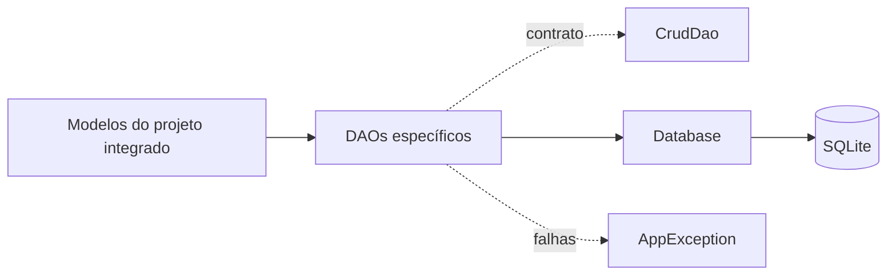

# Nutrimind Persistence

Camada de acesso a dados em Java para a plataforma de gestão nutricional Nutrimind. Reúne contratos DAO, consultas JDBC e gerenciamento de conexão com SQLite.

**Estado:** módulo parcial. Este repositório não é uma aplicação executável isolada.

[Componentes](#componentes) · [Integração](#integração) · [Estrutura](#estrutura) · [Limitações](#limitações)

## Contexto

Módulo desenvolvido de forma colaborativa para o Nutrimind. A contribuição registrada de Guilherme Estrela é a camada de persistência e a integração com o banco.

A [versão integrada do grupo](https://github.com/karlitus222/nutrimind-mvp-desktop) está em outro repositório, mantido pela equipe.

## Componentes

| Componente | Responsabilidade |
| --- | --- |
| `Database` | Gerenciamento da conexão SQLite, inicialização e encerramento |
| `CrudDao<T, ID>` | Contrato genérico das operações CRUD |
| `UserDao` | Persistência de usuários |
| `PatientDao` | Persistência de pacientes |
| `ConsultationDao` | Persistência de consultas |
| `ReportDao` | Consultas para relatórios |
| `AppException` | Encapsulamento de falhas da aplicação |



## Integração

Os fontes ficam em `src/main/java/br/com/nutrimind/`. Eles dependem das classes de modelo de `br.com.nutrimind.model` e do driver JDBC do SQLite.

Esta cópia não contém os modelos, `pom.xml`, esquema inicial completo nem classe principal. Portanto, `mvn clean install` não é um comando válido para este repositório isolado. Para executar o produto, siga as instruções do MVP integrado.

## Estrutura

```text
src/main/java/br/com/nutrimind/
├── config/       Conexão com o banco
├── dao/          Contratos e implementações de persistência
└── exception/    Exceções da aplicação
```

## Decisões de projeto

- **SQLite:** armazenamento local sem servidor de banco dedicado.
- **DAO:** separação entre as operações de dados e os consumidores da aplicação.
- **Conexão centralizada:** configuração compartilhada em `Database`.

## Limitações

Não há suíte de testes DAO nesta cópia. A apresentação dos componentes descreve o código disponível, sem comprovar integração ponta a ponta. Relatórios em PDF e plano alimentar personalizado não fazem parte desta entrega.

## Autoria e equipe

Desenvolvimento colaborativo. Contribuição documentada neste repositório: **Guilherme Estrela — camada de persistência e integração com o banco**. As demais responsabilidades devem ser consultadas na documentação da equipe.
